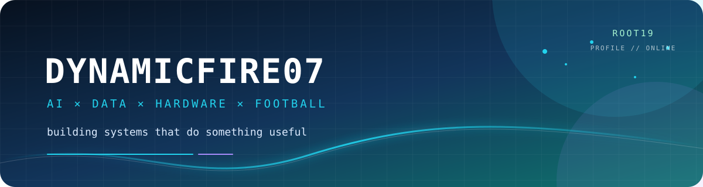
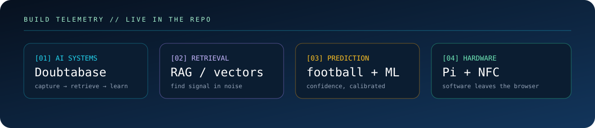

<!--
  Profile README for Shaurya Jain / Dynamicfire07.
  Visuals are stored in ./assets so GitHub does not depend on third-party image proxies.
-->

<p align="center">
  
</p>

<p align="center">
  <strong>hey, I’m Shaurya 👋</strong><br />
  <code>AI systems</code> · <code>weird tools</code> · <code>football models</code> · <code>ROOT19</code>
</p>

<p align="center">
  <a href="https://github.com/shauryajain07"><code>github.com/shauryajain07</code></a>
  ·
  <a href="https://github.com/shauryajain07?tab=repositories"><code>explore the experiments</code></a>
  ·
  <a href="https://shaurya-jain-portfolio.dynamic-0947.chatgpt.site"><code>portfolio</code></a>
  ·
  <code>status: shipping</code>
</p>

<br />

<table align="center">
  <tr>
    <td width="56%" valign="top">

## `whoami`

```text
┌──(shaurya㉿github)-[~/profile]
└─$ ./run_profile.sh

  role       →  engineering student / builder / tinkerer
  focus      →  AI that fits into real human workflows
  instinct   →  “there has to be a better way — I’ll build it”
  weakness   →  turning one feature into an entire product
  status     →  [███████████████████░] shipping
```

    </td>
    <td width="44%" valign="top">

## `now()`

```yaml
building:   Doubtabase + useful little systems
learning:   deep learning, RAG, agents, ML
experiment: predicting the Premier League
hardware:   Raspberry Pi + NFC-shaped chaos
listening:  Oasis / rock
watching:   Manchester City
community:  ROOT19
```

    </td>
  </tr>
</table>

<details>
  <summary><b>🧠 the lore, if you’re curious</b></summary>
  <br />

  I’m a builder-first engineering student interested in the overlap between AI, product design, data, and slightly over-engineered solutions to everyday problems.

  I like systems that can **remember**, **measure**, **predict**, **organise**, or **automate** something real. A model demo is cool; a model that quietly makes a person’s day easier is much cooler.

  <blockquote>
    <i>“Building software while waiting for City to play again.”</i>
  </blockquote>
</details>

## experience

- **Lead Software Engineer · Rootatom** *(2024–2026)* — led full-stack engineering for a student practice and progress platform.
- **Machine Learning Intern · Pharmint** *(2025)* — researched how ML could support cancer-cell research.
- **Freelance builder** *(2020–2026)* — built websites, small tools, automations, and experiments across web, software, and ML.

## 🌱 ROOT19

<p align="center">
  <code>ROOT19 // builder in progress</code>
</p>

> Building, experimenting, and shipping through ROOT19.

## 🧪 the builder’s lab

```text
CURRENT EXPERIMENTS

[AI]       Doubtabase                capture → retrieve → understand student doubts
[ML]       Premier League Predictor  features, form, upsets, and suspicious confidence
[TOOLS]    Question Timer             a Chrome extension with opinions about UX
[HARDWARE] NFC Raspberry Pi Alarm    because alarms should require a physical object
[SYSTEMS]  Academic Concierge         making student life slightly less fragmented
[???]      next weird thing            currently loading...
```

<table align="center">
  <tr>
    <td width="50%" valign="top">

### [Doubtabase](https://github.com/shauryajain07/doubtabase)

A native SwiftUI macOS app for turning difficult question screenshots into searchable learning data with local OCR and semantic retrieval.

`AI` `RAG` `vector search` `education`

    </td>
    <td width="50%" valign="top">

### [Premier League Predictor](https://github.com/shauryajain07/pram-league)

An ML experiment exploring player performance signals, chronological features, leakage, calibration, and the limits of statistical confidence.

`Python` `ML` `data` `football`

    </td>
  </tr>
  <tr>
    <td width="50%" valign="top">

### [Question Timer](https://github.com/shauryajain07/question-timer)

A Chrome extension where the small details matter: resizing, persistence, positioning, and making the interface behave properly in the real world.

`browser extension` `UX` `JavaScript`

    </td>
    <td width="50%" valign="top">

### [Raspberry Pi experiments](https://github.com/shauryajain07/nfc-alarm)

Agentic files, NFC alarms, and hardware experiments that make software leave the browser and touch reality.

`Raspberry Pi` `agents` `hardware` `automation`

    </td>
  </tr>
  <tr>
    <td width="50%" valign="top">

### [Past Paper Tracker](https://github.com/shauryajain07/PastPaperTracker)

A SwiftUI iPhone app for logging marks, tracking mistakes, attaching question photos, and keeping revision data together.

`SwiftUI` `iOS` `Supabase` `learning tools`

    </td>
    <td width="50%" valign="top">

### [Alma Academic OS](https://github.com/shauryajain07/Personal-Concierge)

A full-stack academic workspace that connects deadlines, grades, notes, study history, and available time to answer: what should I work on right now?

`Next.js` `TypeScript` `SQLite` `Codex`

    </td>
  </tr>
</table>

## ⚽ Shaurya’s starting XI

```text
                         ┌──────────────────────┐
                         │      AI AGENTS       │
                         │   the final third    │
                         └──────────┬───────────┘
                ┌──────────────────┼──────────────────┐
                │                  │                  │
        ┌───────▼───────┐  ┌───────▼───────┐  ┌───────▼───────┐
        │      RAG      │  │      ML       │  │  DATA / FE    │
        │  finds signal │  │  makes bets   │  │  makes it real │
        └───────┬───────┘  └───────┬───────┘  └───────┬───────┘
                │                  │                  │
        ┌───────▼──────────────────▼──────────────────▼───────┐
        │             PYTHON  ·  GIT  ·  CURIOSITY             │
        └────────────────────────┬────────────────────────────┘
                                 │
                         ┌───────▼───────┐
                         │  RASPBERRY PI │
                         │  plays dirty  │
                         └───────────────┘
```

## ⚙️ tools I actually use

<p align="center">
  <code>Python</code>
  <code>Git / GitHub</code>
  <code>Raspberry Pi</code>
  <code>Chrome Extensions</code>
  <code>RAG</code>
  <code>Vector Databases</code>
  <code>Machine Learning</code>
  <code>AI Agents</code>
</p>

## 📡 build telemetry

<p align="center">
  
</p>

<table align="center">
  <tr>
    <td align="center"><b>public projects</b><br /><a href="https://github.com/shauryajain07?tab=repositories">browse the repos →</a></td>
    <td align="center"><b>live contribution graph</b><br /><a href="https://github.com/shauryajain07">view the profile →</a></td>
    <td align="center"><b>current homebase</b><br /><code>ROOT19</code></td>
  </tr>
</table>

<details>
  <summary><b>🎧 the music / football settings</b></summary>
  <br />

  ```text
  soundtrack  = Oasis + loud guitars
  matchday    = Manchester City
  side quest  = make the README technically serious but never boring
  philosophy  = build first, polish second, ship eventually
  ```
</details>

<details>
  <summary><b>🕳️ you found the easter egg</b></summary>
  <br />

  ```text
  achievement: CURIOUS HUMANS ONLY
  reward:     absolutely nothing
  side quest: star a repo if something here made you smile
  ```
</details>

<p align="center">
  <a href="https://github.com/shauryajain07/doubtabase">doubtabase</a>
  ·
  <a href="https://github.com/shauryajain07/question-timer">question timer</a>
  ·
  <a href="https://github.com/shauryajain07/nfc-alarm">nfc alarm</a>
  ·
  <a href="https://github.com/shauryajain07">follow the build log</a>
</p>

<p align="center">
  
</p>
